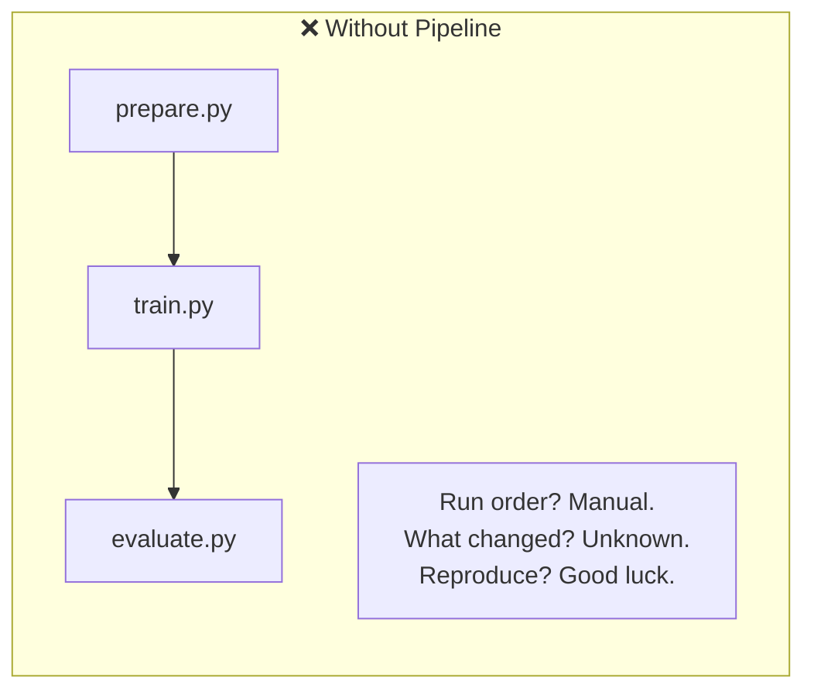
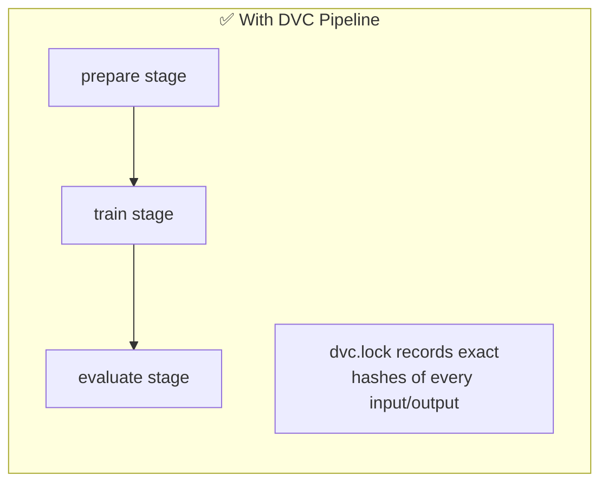
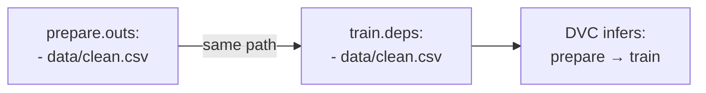
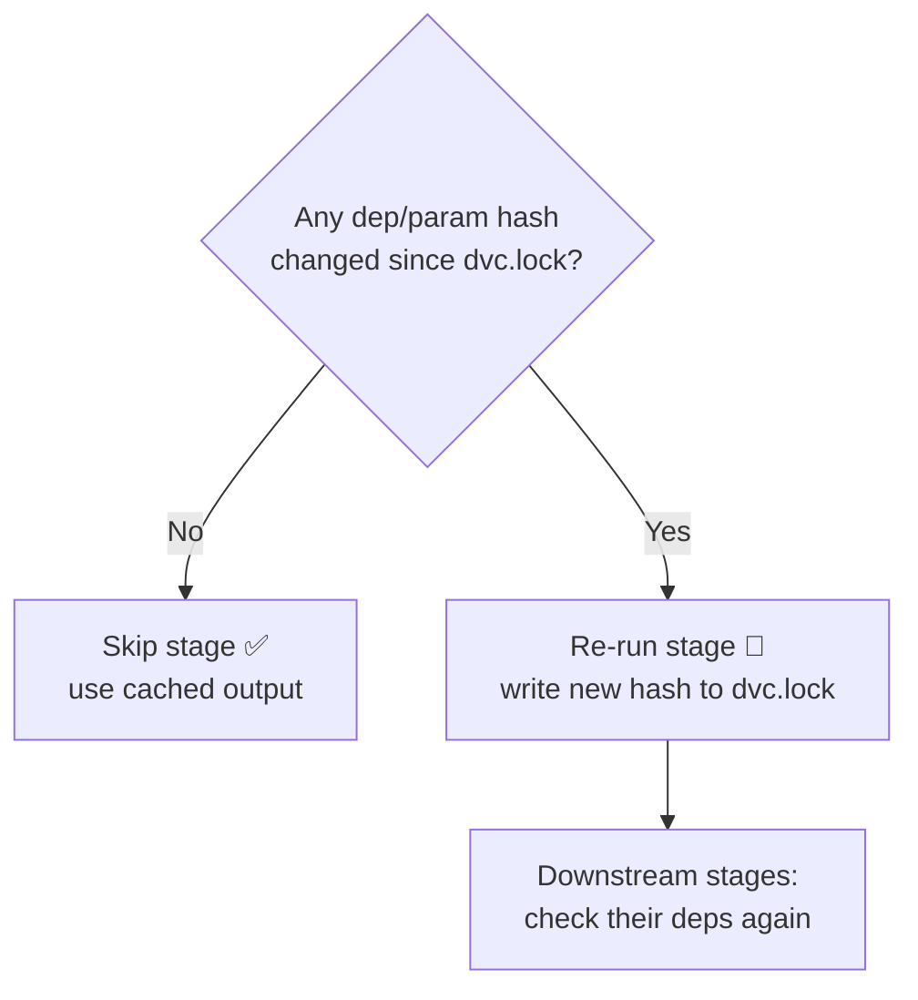
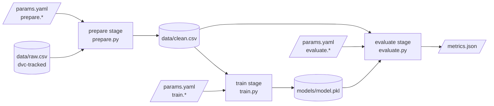
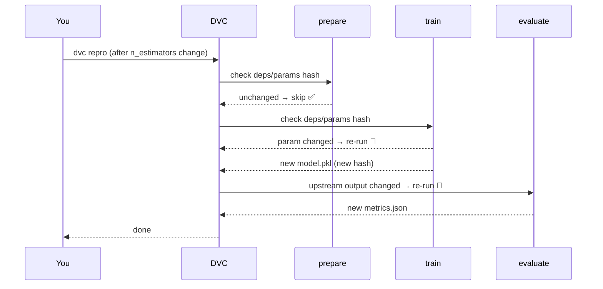
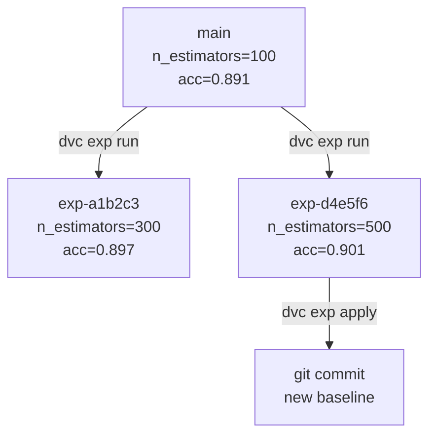

# DVC Pipelines

> **Goal:** Turn a bag of scripts into a tracked, reproducible, incremental ML pipeline.
> Every input, output, and parameter is versioned. Re-run only what changed.

---

## 0. Why Pipelines?

Without a pipeline, ML workflows look like this:

```bash
python src/prepare.py
python src/train.py
python src/evaluate.py
```

Problems:

| Pain | Reality |
|------|---------|
| No record of what ran | Did you retrain after the data changed? |
| Full re-run every time | 2-hour training job for a 1-line code fix |
| Params scattered | Hardcoded in scripts, lost in Slack messages |
| Can't reproduce | "It worked on my machine" |



DVC pipeline solves all four:



---

## 1. Project Layout

```
ml-project/
├── data/
│   ├── raw.csv             ← tracked by DVC (dvc add)
│   └── clean.csv           ← pipeline output (auto-tracked)
├── models/
│   └── model.pkl           ← pipeline output
├── metrics.json            ← pipeline output (not cached, goes in Git)
├── params.yaml             ← hyperparameters (goes in Git)
├── src/
│   ├── prepare.py
│   ├── train.py
│   └── evaluate.py
├── dvc.yaml                ← pipeline definition (goes in Git)
└── dvc.lock                ← pipeline snapshot / lock (goes in Git)
```

---

## 2. `params.yaml` — Centralise Hyperparameters

Instead of hardcoding values in scripts, put them here:

```yaml
prepare:
  test_split: 0.2
  random_state: 42

train:
  n_estimators: 100
  max_depth: 5
  random_state: 42

evaluate:
  threshold: 0.5
```

Scripts read params at runtime:

```python
import yaml

params = yaml.safe_load(open("params.yaml"))["train"]
n_estimators = params["n_estimators"]   # 100
```

> **Rule:** params live in `params.yaml`, not in script arguments or env vars. DVC tracks them — if a param changes, the affected stage re-runs.

---

## 3. `dvc.yaml` — Define the Pipeline

Each stage has five possible keys: `cmd`, `deps`, `params`, `outs`, `metrics`.

### Anatomy of one stage

```yaml
stages:
  train:                          # stage name — you choose it
    cmd: python src/train.py      # shell command DVC will run
    deps:                         # inputs DVC watches for changes
      - src/train.py              #   the script itself is a dep
      - data/clean.csv            #   data from upstream stage
    params:                       # hyperparams pulled from params.yaml
      - train.n_estimators        #   dotted path: file.key
      - train.max_depth
    outs:                         # outputs DVC caches and tracks
      - models/model.pkl
```

### Key by key

| Key | What it does | Change triggers re-run? |
|-----|-------------|------------------------|
| `cmd` | Shell command to execute | Yes — if cmd text changes |
| `deps` | Files/dirs this stage reads | Yes — if content hash changes |
| `params` | Values from `params.yaml` | Yes — if value changes |
| `outs` | Files this stage produces; DVC caches them | No (these are outputs) |
| `metrics` | Like `outs` but for small metric files | No (outputs) |
| `plots` | Like `metrics` but rendered as charts | No (outputs) |

### `outs` options

```yaml
outs:
  - data/clean.csv                # default: cached + git-ignored

  - models/model.pkl:
      cache: true                 # (default) store in .dvc/cache + remote
      persist: false              # (default) delete before re-run

  - reports/summary.html:
      cache: false                # NOT cached — small file, keep in Git
```

### `metrics` vs `outs`

```yaml
metrics:
  - metrics.json:
      cache: false    # small JSON — goes in Git, not DVC remote
                      # enables: dvc metrics diff, dvc metrics show
```

Use `metrics` (not `outs`) for any file you want to compare across commits with `dvc metrics diff`.

### Full `dvc.yaml` example

```yaml
stages:
  prepare:
    cmd: python src/prepare.py
    deps:
      - src/prepare.py
      - data/raw.csv
    params:
      - prepare.test_split
      - prepare.random_state
    outs:
      - data/clean.csv

  train:
    cmd: python src/train.py
    deps:
      - src/train.py
      - data/clean.csv
    params:
      - train.n_estimators
      - train.max_depth
      - train.random_state
    outs:
      - models/model.pkl

  evaluate:
    cmd: python src/evaluate.py
    deps:
      - src/evaluate.py
      - models/model.pkl
      - data/clean.csv
    params:
      - evaluate.threshold
    metrics:
      - metrics.json:
          cache: false
```

### How DVC builds the graph automatically

DVC doesn't need you to declare stage order. It infers the DAG from **data flow**: if stage B lists `data/clean.csv` as a dep, and stage A lists it as an out, B depends on A.



### How DVC knows what to re-run



DVC hashes every `dep` file and every `param` value and compares against `dvc.lock`. If nothing changed, stage skipped. If upstream re-runs and produces new output hash, all downstream stages invalidate and re-run.

---

## 4. Pipeline DAG



Visualise it live:

```bash
dvc dag
```

```
        +------------------+
        | data/raw.csv.dvc |
        +------------------+
                 *
                 *
           +---------+
           | prepare |
           +---------+
                 *
                 *
            +-------+
            | train |
            +-------+
                 *
                 *
           +----------+
           | evaluate |
           +----------+
```

---

## 5. Run the Pipeline

### First run

```bash
dvc repro
# Running stage 'prepare':  python src/prepare.py
# Running stage 'train':    python src/train.py
# Running stage 'evaluate': python src/evaluate.py
```

### Second run — nothing changed

```bash
dvc repro
# Stage 'prepare' didn't change, skipping
# Stage 'train'   didn't change, skipping
# Stage 'evaluate' didn't change, skipping
```

### After changing a param

```bash
# Edit params.yaml: n_estimators: 200
dvc repro
# Stage 'prepare' didn't change, skipping     ← data untouched, skip
# Running stage 'train':    python src/train.py   ← param changed, re-run
# Running stage 'evaluate': python src/evaluate.py ← upstream changed, re-run
```



---

## 6. `dvc.lock` — The Reproducibility Record

After `dvc repro`, DVC writes `dvc.lock`:

```yaml
schema: '2.0'
stages:
  prepare:
    cmd: python src/prepare.py
    deps:
    - path: data/raw.csv
      md5: a304afb96060aad90176268345e10355
    - path: src/prepare.py
      md5: 3c2d4f...
    params:
      params.yaml:
        prepare.test_split: 0.2
        prepare.random_state: 42
    outs:
    - path: data/clean.csv
      md5: 9f12bc...

  train:
    cmd: python src/train.py
    deps:
    - path: data/clean.csv
      md5: 9f12bc...
    params:
      params.yaml:
        train.n_estimators: 100
    outs:
    - path: models/model.pkl
      md5: 7e3a1d...
```

This file is **the proof of reproducibility** — it records the exact hash of every input and output. Commit it to Git.

```bash
git add dvc.yaml dvc.lock params.yaml
git commit -m "pipeline: add prepare→train→evaluate"
dvc push   # upload outputs (clean.csv, model.pkl) to remote
```

---

## 7. Compare Runs — Params & Metrics Diff

```bash
dvc params diff          # compare current workspace vs last commit
```

```
Path                  Param               Old    New
params.yaml           train.n_estimators  100    200
```

```bash
dvc metrics diff         # compare metrics across commits
```

```
Path          Metric    Old      New      Change
metrics.json  accuracy  0.891    0.903    +0.012
metrics.json  f1        0.874    0.889    +0.015
```

---

## 8. Run Experiments Without Touching Files

```bash
dvc exp run --set-param train.n_estimators=300
dvc exp run --set-param train.n_estimators=500
```

Each `exp run` is isolated — no file edits, no manual commits.

View all experiments:

```bash
dvc exp show
```

```
─────────────────────────────────────────────
  Experiment           accuracy   n_estimators
─────────────────────────────────────────────
  workspace            0.903      200
  main                 0.891      100
  exp-a1b2c3           0.897      300
  exp-d4e5f6           0.901      500
─────────────────────────────────────────────
```

Promote the winner to a real commit:

```bash
dvc exp apply exp-d4e5f6   # apply params + outputs to workspace
git add .
git commit -m "exp: n_estimators=500, accuracy=0.901"
dvc push
```



---

## 9. Cheatsheet

```bash
dvc repro                              # run pipeline (skip unchanged stages)
dvc dag                                # visualise pipeline graph
dvc params diff                        # param changes vs last commit
dvc metrics diff                       # metric changes vs last commit
dvc exp run --set-param key=val        # run experiment without editing files
dvc exp show                           # table of all experiments
dvc exp apply <exp-id>                 # promote best experiment to workspace
dvc push                               # upload all outputs to remote
```

| File | Lives in | Purpose |
|------|----------|---------|
| `dvc.yaml` | Git | Pipeline definition (stages, deps, params, outs) |
| `dvc.lock` | Git | Reproducibility snapshot (exact hashes) |
| `params.yaml` | Git | Hyperparameters |
| `metrics.json` | Git (`cache: false`) | Metric values per commit |
| `data/clean.csv` | DVC remote | Pipeline output (large file) |
| `models/model.pkl` | DVC remote | Pipeline output (large file) |
