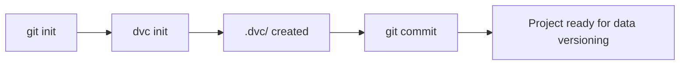
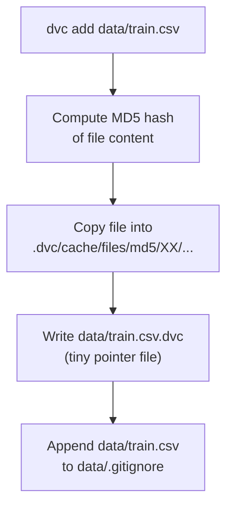
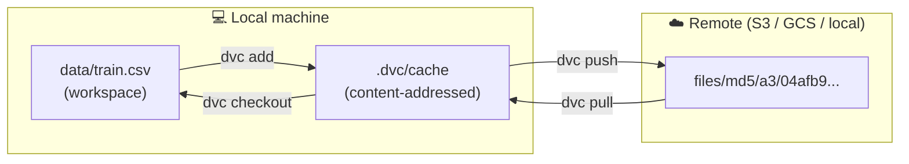
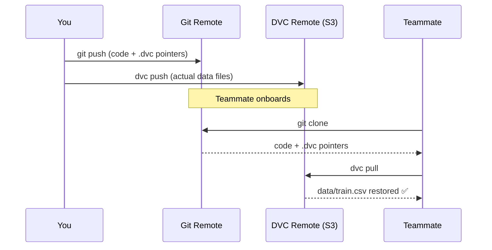
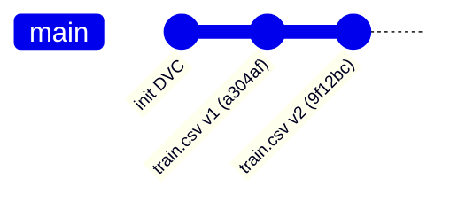
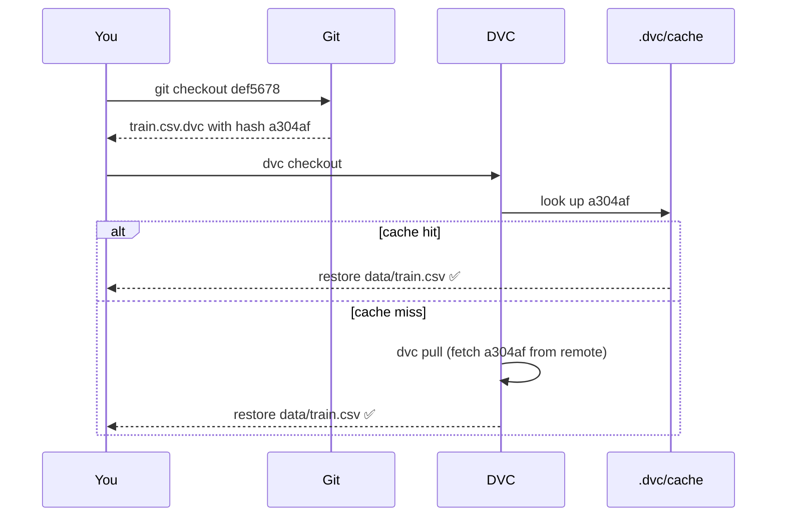
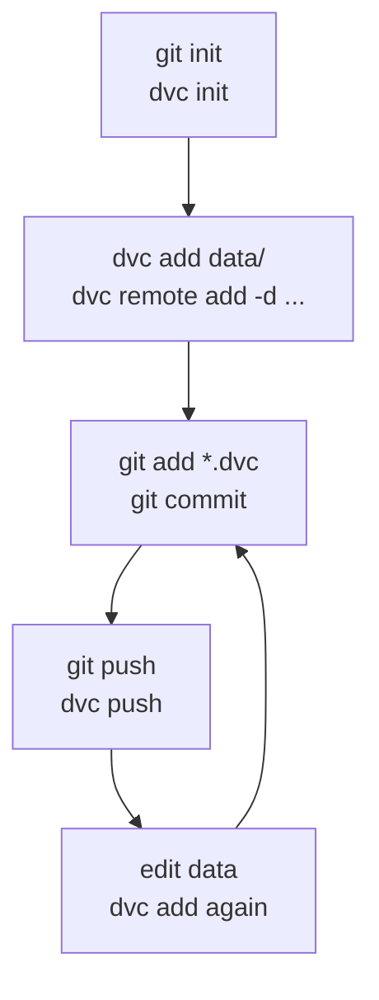

# Getting Started with DVC

> **Goal:** Go from zero to tracked, versioned data with DVC.
> You'll track data, push to remote storage, and restore any past version.

---

## 0. Prerequisites

### pip

```bash
pip install dvc            # core
pip install "dvc[s3]"      # + S3 support
pip install "dvc[gs]"      # + GCS support
pip install "dvc[all]"     # all remotes
```

### uv (faster)

```bash
uv add dvc                 # core
uv add "dvc[s3]"           # + S3 support
uv add "dvc[gs]"           # + GCS support
uv add "dvc[all]"          # all remotes
```

> `uv` resolves and installs ~10× faster than pip. Use `uv add` inside a `uv`-managed project, or `uv pip install` as a drop-in pip replacement.

Check install:

```bash
dvc --version   # e.g. 3.x.x
git --version   # DVC needs Git
```

---

## 1. Initialize a DVC Project

```bash
mkdir ml-project && cd ml-project
git init
dvc init
```

What `dvc init` creates:

```
ml-project/
├── .dvc/
│   ├── config          ← remote storage settings
│   ├── .gitignore      ← auto-ignores cache
│   └── cache/          ← local content-addressed store
└── .dvcignore          ← like .gitignore but for DVC
```

Commit the scaffold:

```bash
git add .dvc .dvcignore
git commit -m "chore: init DVC"
```



---

## 2. Track Your First Data File

Assume you have a dataset at `data/train.csv` (any large file works).

```bash
mkdir data
# put or copy your CSV here
dvc add data/train.csv
```

DVC does three things:



The generated pointer file `data/train.csv.dvc`:

```yaml
outs:
- md5: a304afb96060aad90176268345e10355
  size: 14445097
  hash: md5
  path: train.csv
```

Commit the pointer — **not** the data:

```bash
git add data/train.csv.dvc data/.gitignore
git commit -m "data: track train.csv v1"
```

> **Rule:** `git` owns `.dvc` files. `dvc` owns the payload.

---

## 3. Connect Remote Storage

Remote storage is where the actual files live. Local cache is just a fast layer in front of it.

### Option A — Local / NFS path (quickest for testing)

```bash
dvc remote add -d myremote /tmp/dvc-store
```

### Option B — S3

```bash
dvc remote add -d myremote s3://my-bucket/dvc-store
dvc remote modify myremote region us-east-1
```

### Option C — Google Cloud Storage

```bash
dvc remote add -d myremote gs://my-bucket/dvc-store
```

Config lands in `.dvc/config`:

```ini
[core]
    remote = myremote
['remote "myremote"']
    url = s3://my-bucket/dvc-store
```

Commit the config:

```bash
git add .dvc/config
git commit -m "chore: add S3 DVC remote"
```



---

## 4. Push and Pull Data

### Push (upload to remote)

```bash
dvc push
# Pushing 1 file to s3://my-bucket/dvc-store
```

### Teammate setup (clone repo and get data)

```bash
git clone https://github.com/you/ml-project
cd ml-project
dvc pull          # downloads files matching the .dvc pointers
```

### Full round-trip



---

## 5. Update Data and Create a New Version

```bash
# Modify the dataset (e.g. add new rows, clean duplicates)
python scripts/clean.py   # overwrites data/train.csv

dvc add data/train.csv    # re-hash, update .dvc pointer
git add data/train.csv.dvc
git commit -m "data: cleaned train.csv v2"
dvc push
```

Git now has two commits pointing to two different data hashes:



---

## 6. Time Travel — Restore Any Past Data Version

```bash
git log --oneline
# abc1234 data: cleaned train.csv v2
# def5678 data: track train.csv v1

git checkout def5678        # code + .dvc pointer go back to v1
dvc checkout                # data follows the pointer
```



---

## 7. Check Status (Quick Reference)

```bash
dvc status          # what changed locally vs cache
dvc status --cloud  # what's out of sync with remote
```

```
data/train.csv.dvc:
    changed outs:
        modified: data/train.csv
```

---

## 8. Full Workflow Cheatsheet



```bash
# Day-to-day loop
dvc add data/train.csv             # track new/updated data
git add data/train.csv.dvc
git commit -m "data: ..."
dvc push                           # upload to remote
```

| Git command    | DVC counterpart | Purpose                     |
|----------------|-----------------|-----------------------------|
| `git add`      | `dvc add`       | Start tracking a file       |
| `git push`     | `dvc push`      | Upload data to remote       |
| `git pull`     | `dvc pull`      | Download data from remote   |
| `git checkout` | `dvc checkout`  | Sync workspace to a version |
| `git status`   | `dvc status`    | Show what changed           |
