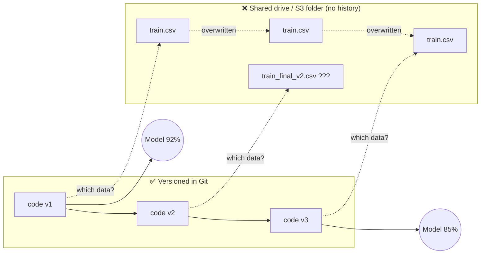
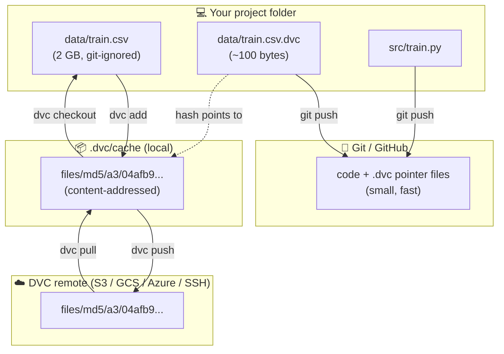
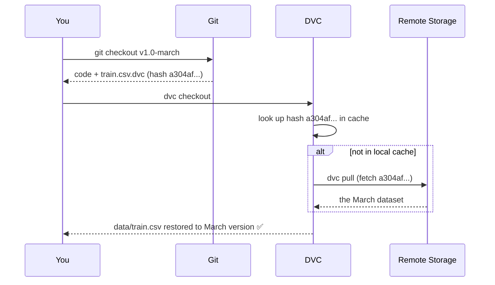
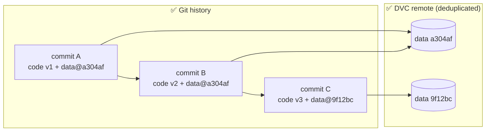
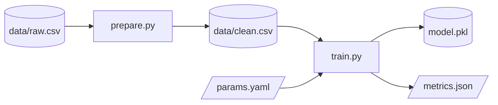

# Why Data Versioning? (and Why DVC)

> **TL;DR:** In ML, the code alone doesn't make the model. **Code + data + parameters** make the model.
> Git versions code well but cannot version large data. DVC lets Git track your data
> *by reference*: small pointer files live in Git, and the heavy files live in cheap storage.

---

## 1. The Problem Statement

### A story every ML engineer has lived through

1. In March you train a model on `train.csv` and get **92% accuracy**. 🎉
2. In April a teammate cleans the dataset, removes duplicates and adds new rows. They overwrite `train.csv`.
3. In May a stakeholder asks: *"Why did the production model start predicting worse? Can you reproduce March's model?"*
4. You `git checkout` the March commit. The **code** goes back to March, but the **data** doesn't, because the data was never in Git.
5. You find `train_final.csv`, `train_final_v2.csv`, `train_final_v2_REALLY_final.csv` on a shared drive. Nobody knows which one produced the 92%.

**Result:** the model can't be reproduced, debugged or audited.

### Diagram: life without data versioning



There is **no link** between a code commit and the exact data it was trained on.

### Why not just put the data in Git?

| Problem | Explanation |
|---|---|
| **File size limits** | GitHub rejects files over 100 MB and warns from 50 MB. Datasets are often GBs or TBs. |
| **Repo bloat** | Git stores a full copy of a binary file on every change. A 2 GB file changed 10 times becomes about 20 GB of history that every `git clone` downloads. |
| **Slow operations** | `git status`, `clone` and `checkout` become painfully slow with large binaries. |
| **No meaningful diffs** | Git line diffs are useless for images, Parquet files, model weights and similar data. |

### What we actually need

A data versioning system for ML should:

- ✅ **Tie data to code.** Every Git commit should point to the exact data version.
- ✅ **Handle large files** without bloating the Git repo.
- ✅ **Time travel.** Restore any past dataset or model with one command.
- ✅ **Share data** across the team and CI without "send me the file on Slack".
- ✅ **Be storage agnostic.** Work with S3, GCS, Azure, SSH or a local disk.
- ✅ **Reproduce pipelines.** Know which data, code and params produced which model.
- ✅ **Avoid duplication.** Don't store the same file twice.

---

## 2. How DVC Solves It

**DVC (Data Version Control)** is an open-source tool that works *on top of Git*.

### The core idea: Git tracks pointers, storage holds the data

Instead of committing `train.csv` (2 GB) to Git, DVC:

1. Computes a **hash** (MD5) of the file's content.
2. Moves the file into a local **cache**, organised by that hash.
3. Writes a tiny **`.dvc` pointer file** (a few lines of YAML) that **you commit to Git**.
4. Adds the real file to `.gitignore` so Git never sees it.
5. Pushes the real file to **remote storage** (S3, GCS, etc.) on `dvc push`.



### What a `.dvc` pointer file looks like

```yaml
# data/train.csv.dvc  ← this is what Git stores
outs:
- md5: a304afb96060aad90176268345e10355
  size: 14445097
  hash: md5
  path: train.csv
```

That's it. The hash **is** the version. If the data changes, the hash changes, the `.dvc`
file changes, and Git records that change like any other code edit.

### Time travel: restoring March's model

Because each Git commit now contains the pointer to the exact data, going back in time takes
**two commands**:



```bash
git checkout v1.0-march   # code + pointers go back in time
dvc checkout              # data follows the pointers
```

### Diagram: life with DVC



Every commit points to **exactly one** data version. Commits A and B share the same data,
so it is stored **once**. That is deduplication for free, thanks to content hashing.

### Bonus: reproducible pipelines

DVC can also version the **process** that turns data into a model, not just the files.



- Stages are defined in **`dvc.yaml`**.
- The exact hashes of every input and output are locked in **`dvc.lock`** (committed to Git).
- `dvc repro` re-runs **only the stages whose inputs changed**, like `make` for ML.
- `dvc params diff` and `dvc metrics diff` compare experiments across commits.

---

## 3. Comparison With Alternatives

| Approach | Large files | Linked to code commit | Dedup | Any cloud storage | Pipelines |
|---|:-:|:-:|:-:|:-:|:-:|
| Data in plain Git | ❌ | ✅ | ❌ | ❌ | ❌ |
| Shared drive / S3 folders | ✅ | ❌ | ❌ | ✅ | ❌ |
| Git LFS | ✅ | ✅ | ⚠️ | ⚠️ (LFS server needed) | ❌ |
| **DVC** | ✅ | ✅ | ✅ | ✅ | ✅ |

---

## 4. The Minimal Workflow

```bash
# one-time setup
git init && dvc init
dvc remote add -d storage s3://my-bucket/dvc-store

# track data
dvc add data/train.csv
git add data/train.csv.dvc data/.gitignore
git commit -m "Track training data v1"
dvc push                 # upload data to remote

# teammate / CI gets everything
git clone <repo> && cd <repo>
dvc pull                 # download the matching data
```

Mental model: **`git` for the pointers, `dvc` for the payload.**

| Git command | DVC counterpart | What it does |
|---|---|---|
| `git add` | `dvc add` | Start tracking a file |
| `git push` | `dvc push` | Upload to remote |
| `git pull` | `dvc pull` | Download from remote |
| `git checkout` | `dvc checkout` | Sync workspace to a version |
| `git status` | `dvc status` | Show what changed |

---

## 5. When You Might *Not* Need DVC

- The dataset is tiny (a few MB) and rarely changes. Plain Git is fine.
- The data already lives in a versioned system (Delta Lake / Iceberg time travel, lakeFS,
  a feature store) and you can reference snapshots by ID.
- One-off exploration notebooks where reproducibility doesn't matter.

---

## 6. Key Takeaways

1. **A model = code + data + params.** Version only one of them and you can't reproduce anything.
2. Git can't handle large data, and shared folders have no history.
3. DVC stores **hashes in Git** and **files in storage**, which links them per commit.
4. `git checkout` + `dvc checkout` restores any past state of the project.
5. Content hashing gives you **deduplication** and **integrity checks** for free.
6. `dvc.yaml` + `dvc.lock` turn the workflow into a **reproducible pipeline**.
