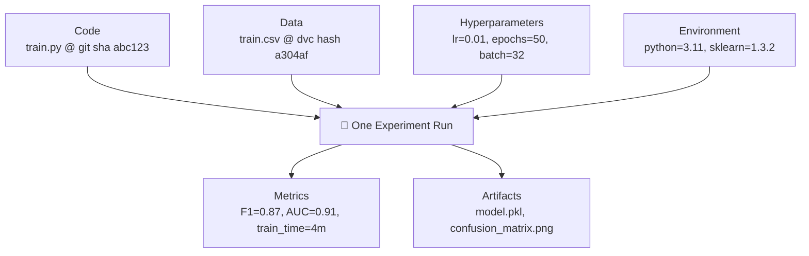
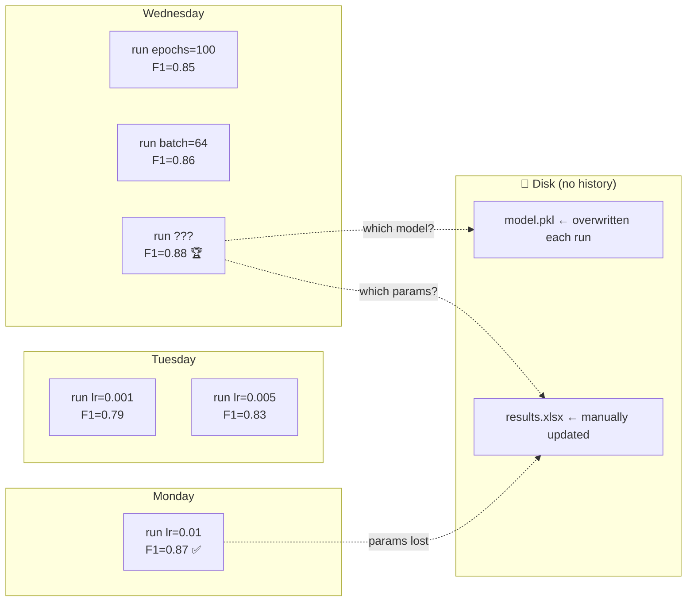
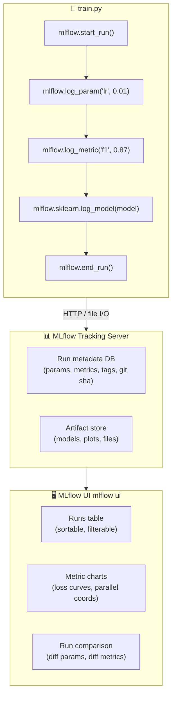
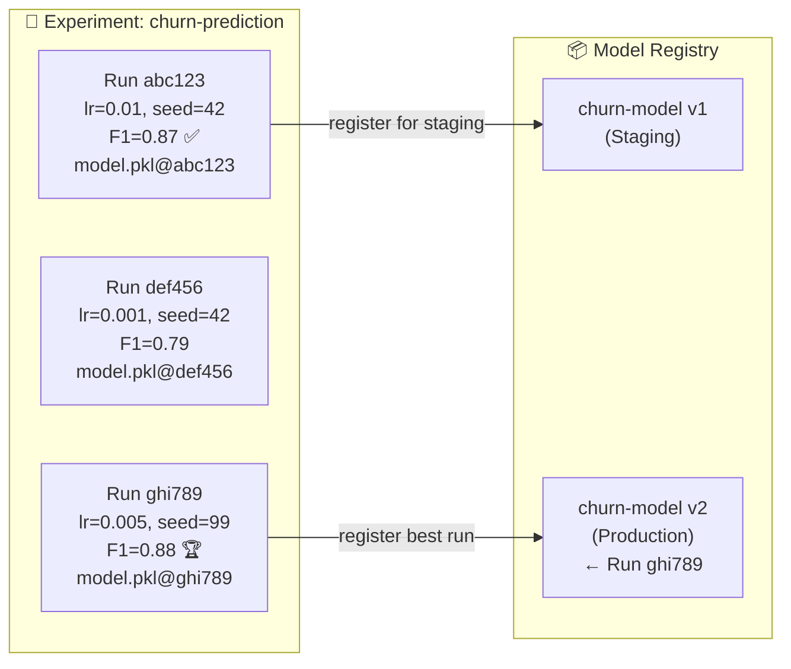
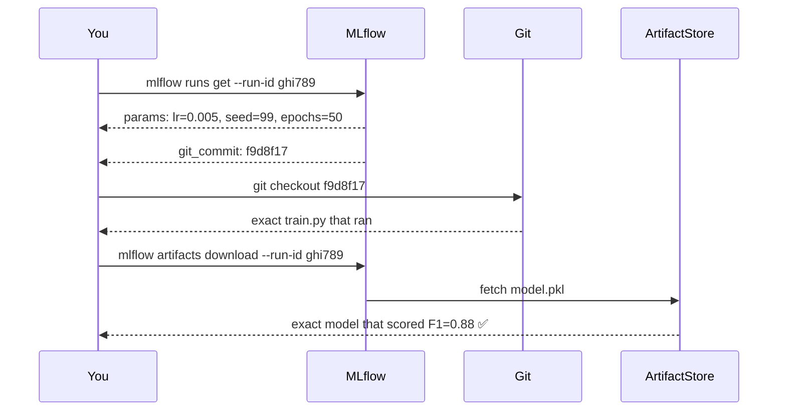
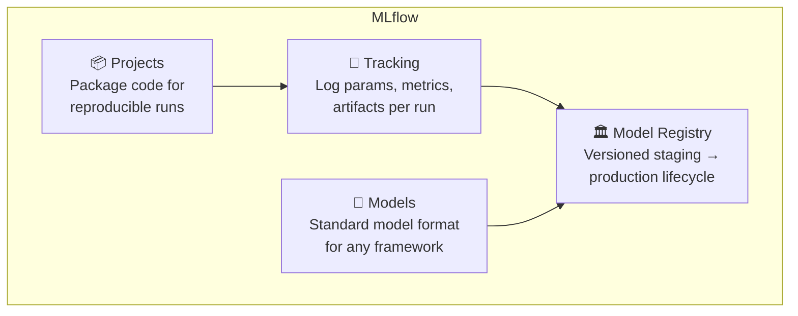
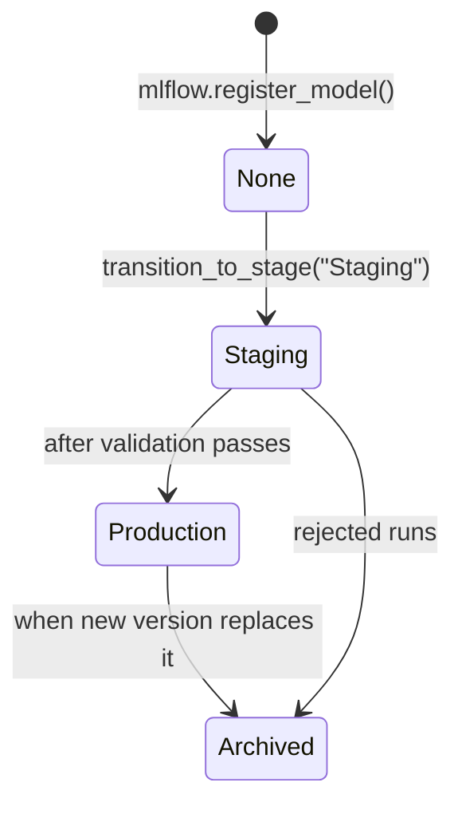
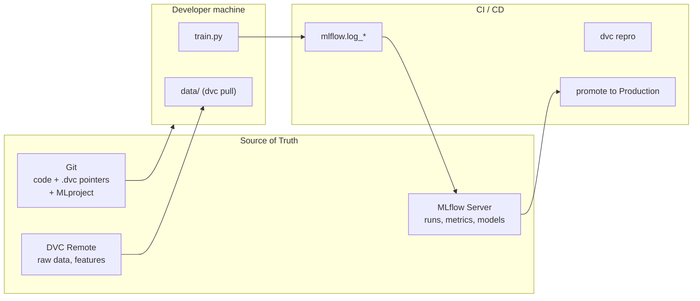

# Why Model Tracking? (and Why MLflow)

> **TL;DR:** A trained model is the product of **code + data + hyperparameters + environment**.
> Change any one of them and you get a different model. Without tracking, you can't tell
> *which* combination produced your best result, can't reproduce it, and can't explain it to anyone.
> MLflow records every experiment automatically so you always know what produced what.

---

## 1. The Problem Statement

### A story every ML engineer has lived through

1. On Monday you train a model with `learning_rate=0.01` and get **F1 = 0.87**. 🎉
2. On Tuesday you try `learning_rate=0.001`, batch size changes, different data split — F1 drops to 0.79.
3. On Wednesday you try ten more combinations, copy-pasting results into a spreadsheet.
4. On Thursday a teammate asks: *"What was your best model? Can you retrain it for production?"*
5. You look at the spreadsheet. The cell for the best run is missing the random seed. The script has been edited three times since then. The conda environment was never saved.
6. You spend two days trying to reproduce 0.87. You get 0.84 at best. Close enough? Nobody knows.

**Result:** the best model exists only as a saved `.pkl` on your laptop, with no audit trail,
no explanation, and no way to prove it's the same model anyone signed off on.

### The axes of the problem

ML experiments are multidimensional. Each run varies across four axes simultaneously:



Without a tracker, **all four axes are unrecorded** for most runs. You only have the last
file that was written to disk.

### Why a spreadsheet doesn't scale

| Problem | Explanation |
|---|---|
| **Manual entry** | You forget to log. You log the wrong value. You log it after editing the script. |
| **No artifact link** | The spreadsheet says F1=0.87 but doesn't point to the actual model file that achieved it. |
| **No code link** | No record of which version of `train.py` was running when that score was achieved. |
| **No environment** | NumPy 1.24 vs 1.26 can produce different results. The spreadsheet doesn't know. |
| **No comparison UI** | Comparing 50 runs across 10 parameters in Excel is painful and error-prone. |
| **No collaboration** | Your teammate's runs live in their spreadsheet. No shared truth. |
| **No reproducibility** | "Run 23 was best" tells you nothing about *how* to recreate Run 23. |

### Diagram: life without experiment tracking



There is **no reliable link** between a metric, the model file that achieved it,
and the exact code and parameters that produced it.

---

## 2. How MLflow Solves It

**MLflow** is an open-source platform for the complete ML lifecycle. Its core feature is
the **Tracking** component: an API + UI that automatically records every experiment run.

### The core idea: every run is a first-class record

When you wrap your training code with MLflow:

1. **A Run is created** with a unique ID, timestamp, and Git commit hash.
2. **Parameters are logged** — hyperparameters, config flags, any scalar you care about.
3. **Metrics are logged** — after each epoch or at the end, with optional step numbers for curves.
4. **Artifacts are logged** — the model file, plots, feature importance, anything you produce.
5. **Environment is captured** — Python version, library versions, OS.
6. All of this is stored in a **Tracking Server** (local folder or remote DB + object store).



### What a minimal tracked run looks like

```python
import mlflow
import mlflow.sklearn
from sklearn.ensemble import RandomForestClassifier
from sklearn.metrics import f1_score

mlflow.set_experiment("churn-prediction")

with mlflow.start_run():
    # log every hyperparameter
    mlflow.log_param("n_estimators", 100)
    mlflow.log_param("max_depth", 5)
    mlflow.log_param("random_state", 42)

    model = RandomForestClassifier(n_estimators=100, max_depth=5, random_state=42)
    model.fit(X_train, y_train)

    f1 = f1_score(y_test, model.predict(X_test))

    # log every metric
    mlflow.log_metric("f1", f1)
    mlflow.log_metric("train_size", len(X_train))

    # log the model itself — MLflow stores it with its own metadata
    mlflow.sklearn.log_model(model, "random-forest-model")
```

That's all. Now every time this script runs, a new row appears in the UI with full
provenance: what params went in, what metrics came out, and the exact model artifact.

### Diagram: life with MLflow



Every run is immutable. You can always go back to Run `ghi789`, click "Reproduce",
and get the exact parameters, the exact model file, and the Git commit that produced it.

### The Run as a reproducibility contract



```bash
# reproduce any past run from scratch
git checkout f9d8f17                              # exact code
dvc checkout                                      # exact data
mlflow runs get --run-id ghi789                   # exact params
python train.py --lr 0.005 --seed 99 --epochs 50  # exact run
```

---

## 3. The Four Pillars of MLflow

MLflow is not just an experiment tracker. It has four integrated components:



### Tracking — the experiment database

Records everything about each run. Queryable via UI or Python API.

```python
# query runs programmatically
runs = mlflow.search_runs(
    experiment_names=["churn-prediction"],
    filter_string="metrics.f1 > 0.85 AND params.max_depth = '5'",
    order_by=["metrics.f1 DESC"]
)
best_run_id = runs.iloc[0].run_id
```

### Projects — reproducible execution

A `MLproject` file defines how to run your code, including the conda environment:

```yaml
# MLproject
name: churn-prediction

conda_env: conda.yaml

entry_points:
  main:
    parameters:
      lr: {type: float, default: 0.01}
      epochs: {type: int, default: 50}
    command: "python train.py --lr {lr} --epochs {epochs}"
```

```bash
# anyone can reproduce any run on any machine
mlflow run . -P lr=0.005 -P epochs=50
```

### Models — framework-agnostic serialization

MLflow defines a standard model format with a `MLmodel` manifest:

```yaml
# MLmodel  (auto-generated by mlflow.sklearn.log_model)
artifact_path: random-forest-model
flavors:
  python_function:
    loader_module: mlflow.sklearn
    python_version: 3.11.4
  sklearn:
    pickled_model: model.pkl
    sklearn_version: 1.3.2
run_id: ghi789
utc_time_created: '2026-11-08 09:14:22'
```

This means the same model can be loaded with a universal API regardless of framework:

```python
# load any MLflow model — sklearn, pytorch, tensorflow, xgboost — same call
model = mlflow.pyfunc.load_model("runs:/ghi789/random-forest-model")
predictions = model.predict(X_test)

# or deploy directly to REST endpoint
mlflow models serve -m "runs:/ghi789/random-forest-model" --port 5001
```

### Model Registry — the production lifecycle

The registry is a versioned catalog with lifecycle stages:



```python
client = mlflow.MlflowClient()

# promote best run to registry
model_uri = f"runs:/{best_run_id}/random-forest-model"
mv = client.create_model_version("churn-model", model_uri, best_run_id)

# move through lifecycle
client.transition_model_version_stage("churn-model", mv.version, "Staging")
# ... run validation tests ...
client.transition_model_version_stage("churn-model", mv.version, "Production")
```

Your serving code always loads `Production`, so deploying a new model is a registry
transition — no code change, no redeploy, fully audited.

---

## 4. MLflow + DVC: the Full Picture

MLflow and DVC solve complementary problems. Together they close every gap:

| What needs versioning | Tool | How |
|---|---|---|
| Code | Git | commits |
| Large data files | DVC | `.dvc` pointer files committed to Git |
| Hyperparameters | MLflow | `mlflow.log_param()` |
| Metrics | MLflow | `mlflow.log_metric()` |
| Model artifacts | MLflow | `mlflow.log_model()` |
| Experiment comparison | MLflow | Tracking UI |
| Production lifecycle | MLflow | Model Registry |
| Pipeline steps | DVC | `dvc.yaml` + `dvc repro` |



The full reproducibility command:

```bash
git checkout v2.3.1          # exact code
dvc checkout                 # exact data
mlflow runs get --run-id XYZ # exact params → paste into config
python train.py              # exact run, logged to MLflow automatically
```

---

## 5. Comparison With Alternatives

| Approach | Auto-logging | Metric curves | Model versioning | Collaboration | Framework agnostic |
|---|:-:|:-:|:-:|:-:|:-:|
| Spreadsheet | ❌ | ❌ | ❌ | ❌ | ✅ |
| TensorBoard | ⚠️ (manual) | ✅ | ❌ | ❌ | ⚠️ (TF/PyTorch) |
| Weights & Biases | ✅ | ✅ | ✅ | ✅ | ✅ |
| Neptune.ai | ✅ | ✅ | ✅ | ✅ | ✅ |
| **MLflow** | ✅ | ✅ | ✅ | ✅ | ✅ |

**MLflow's key advantage:** fully open-source, self-hostable, no vendor lock-in.
You own your data. Run the server on your own infra or in the cloud.

---

## 6. The Minimal Workflow

```bash
# one-time setup
pip install mlflow
mlflow server --host 0.0.0.0 --port 5000   # start tracking server

# in your training code
export MLFLOW_TRACKING_URI=http://localhost:5000
```

```python
import mlflow

mlflow.set_tracking_uri("http://localhost:5000")
mlflow.set_experiment("my-first-experiment")

with mlflow.start_run():
    mlflow.log_param("alpha", 0.5)
    mlflow.log_metric("rmse", 0.73)
    mlflow.sklearn.log_model(model, "model")
```

```bash
# open the UI
mlflow ui --port 5000
# → http://localhost:5000
```

| MLflow concept | Analogy | What it stores |
|---|---|---|
| Experiment | A project folder | Groups related runs |
| Run | One training job | Params + metrics + artifacts |
| Artifact | A file attached to a run | model.pkl, plots, data |
| Model Registry | A versioned catalog | Named models with stage |
| Stage | A deployment slot | Staging / Production / Archived |

---

## 7. When You Might *Not* Need MLflow

- One-off exploratory notebook where results don't matter.
- Already using a platform with built-in tracking (Vertex AI, SageMaker, Azure ML).
- Hyperparameter search is fully managed by Optuna or Ray Tune with their own UIs.

---

## 8. Key Takeaways

1. **A model = code + data + params + environment.** Change any axis untracked and you can't reproduce it.
2. Spreadsheets break at scale — manual, unlinked to artifacts, unlinked to code.
3. MLflow records every run automatically: params, metrics, artifacts, Git commit.
4. The **Model Registry** turns a run into a versioned, auditable production artifact.
5. MLflow + DVC together version the full ML stack: data (DVC) and experiments (MLflow).
6. `mlflow runs get` + `git checkout` + `dvc checkout` = full reproducibility from any past run.
